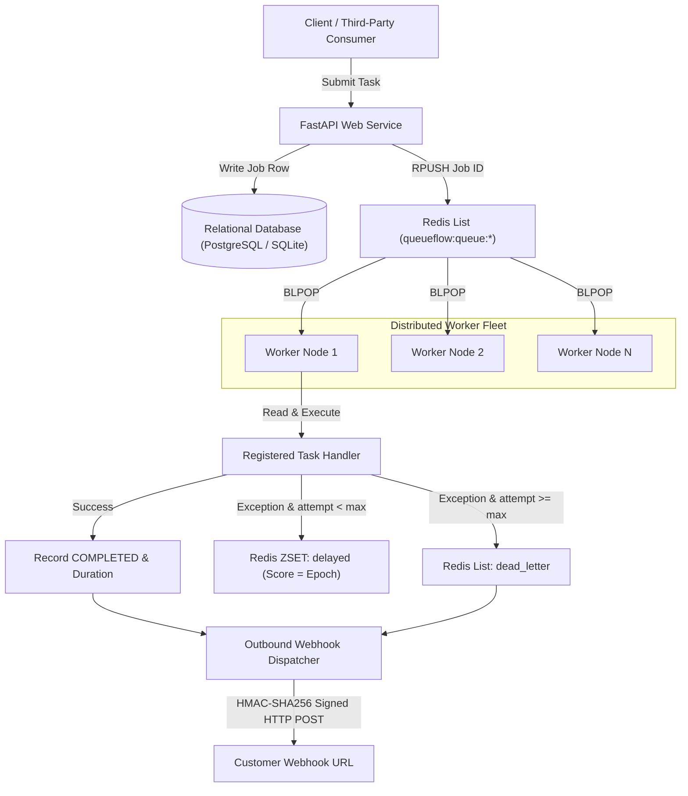
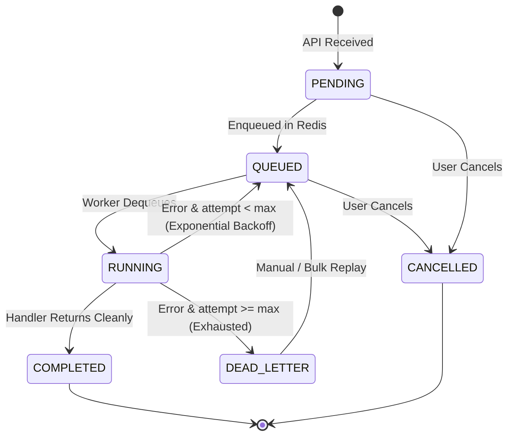
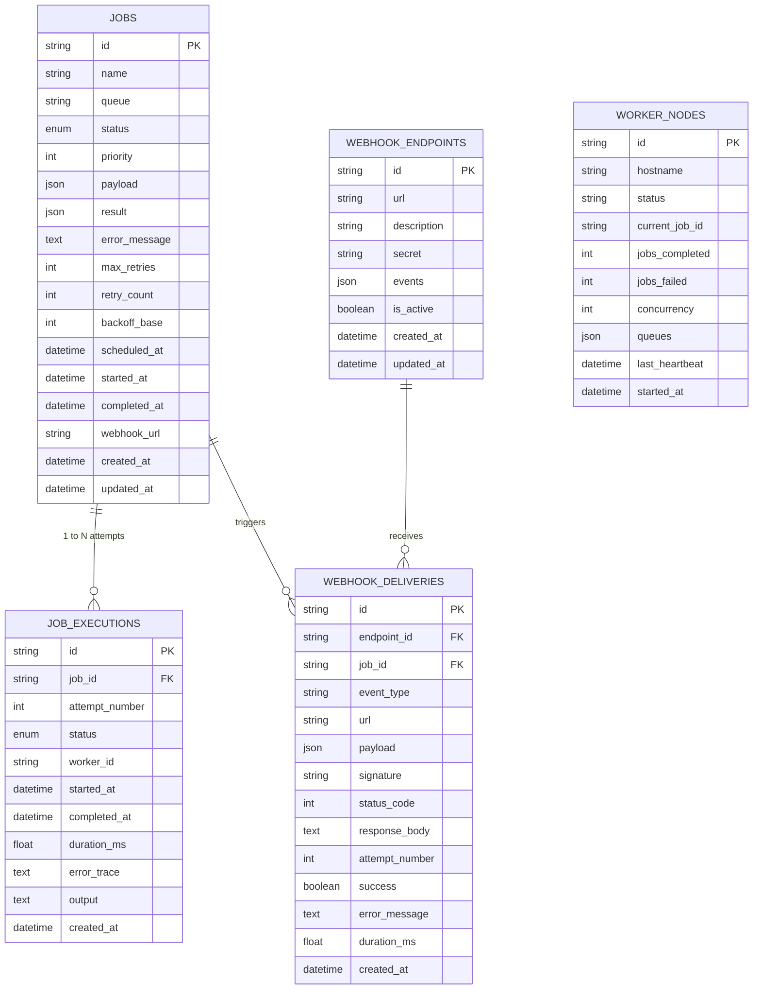

# QueueFlow — Architectural Deep Dive

This document details the architectural design decisions, data structures, concurrency model, and cryptographic protocols powering **QueueFlow**.

---

## 1. High-Level Architectural Topology

QueueFlow is built as a distributed, decoupled background processing system. Web requests never perform long-running operations synchronously; jobs are enqueued onto Redis-backed priority structures and consumed by an autonomous worker fleet.



---

## 2. Distributed Queue Engine Design

QueueFlow implements an acknowledgment-based, resilient Redis broker using native Redis data structures:

### A. Ready Queue (`queueflow:queue:{queue_name}`)
- **Structure**: Redis `LIST`
- **Enqueue**: `RPUSH queueflow:queue:{queue_name} {job_id}`
- **Dequeue**: `BLPOP [queueflow:queue:critical, queueflow:queue:default, queueflow:queue:low] timeout=1`
- **Priority Handling**: Workers poll multiple queues in prioritized order (`critical` before `default`, before `low`).

### B. Delayed Retry Queue (`queueflow:delayed:{queue_name}`)
- **Structure**: Redis `ZSET` (Sorted Set)
- **Score**: Unix epoch timestamp representing when the job is eligible to run again ($now + delay$).
- **Delayed Migration**: Before popping ready tasks, workers run an atomic check:
  ```redis
  ZRANGEBYSCORE queueflow:delayed:{queue_name} 0 {now}
  ```
  Eligible jobs are removed from the ZSET and appended to the ready `LIST` (`RPUSH`), making them immediately available to workers without polling spin-locks.

### C. Dead-Letter Queue (`queueflow:dead_letter`)
- **Structure**: Redis `LIST`
- Stores permanently failed job payloads along with terminal exception diagnostics and timestamps for audit and batch replay.

---

## 3. Job Lifecycle State Machine



---

## 4. Automatic Exponential Backoff Algorithm

When a job execution encounters an uncaught exception, QueueFlow calculates a non-linear backoff delay to give upstream dependencies time to recover:

$$\text{delay} = \text{backoff\_base}^{\text{retry\_count}}$$

For example, with $\text{backoff\_base} = 2$:
- **Attempt 1**: Delay = $2^1 = 2\text{ seconds}$
- **Attempt 2**: Delay = $2^2 = 4\text{ seconds}$
- **Attempt 3**: Delay = $2^3 = 8\text{ seconds}$
- **Attempt 4+**: If $\text{retry\_count} \ge \text{max\_retries}$, job transitions immediately to `DEAD_LETTER`.

---

## 5. Webhook Security & HMAC-SHA256 Signing

To prevent man-in-the-middle tampering, spoofing, and replay attacks, all outbound webhooks are signed using HMAC-SHA256:

### Wire Protocol:
1. When registering an endpoint, a high-entropy secret (`whsec_...`) is generated using `secrets.token_hex(24)`.
2. Outbound HTTP POST payloads are serialized to canonical JSON bytes.
3. The current epoch timestamp is extracted ($T$).
4. The signing string is composed:
   $$\text{string\_to\_sign} = T + "." + \text{payload\_bytes}$$
5. The signature is computed:
   $$\text{signature} = \text{HMAC-SHA256}(\text{secret}, \text{string\_to\_sign})$$
6. Headers included in the HTTP request:
   - `Content-Type: application/json`
   - `User-Agent: QueueFlow-Webhook/1.0`
   - `X-QueueFlow-Delivery: {delivery_uuid}`
   - `X-QueueFlow-Event: {event_type}`
   - `X-QueueFlow-Timestamp: {epoch}`
   - `X-QueueFlow-Signature: sha256={hex_digest}`
7. Signature verification on the client side is performed using constant-time string comparison (`hmac.compare_digest`) to prevent timing attacks.

---

## 6. Database Entity-Relationship Model



---

## 7. Fault Tolerance & Dead Worker Detection

- **Heartbeat Protocol**: Workers refresh their `last_heartbeat` in the database every 5 seconds.
- **Heartbeat Window**: A worker that fails to send a heartbeat within 30 seconds (`WORKER_OFFLINE_THRESHOLD_SECONDS`) is automatically marked `DISCONNECTED` by the system telemetry.
- **Dual-Mode Broker**: Seamlessly operates with production multi-container Redis or development in-memory FakeRedis without altering application code or test pipelines.
