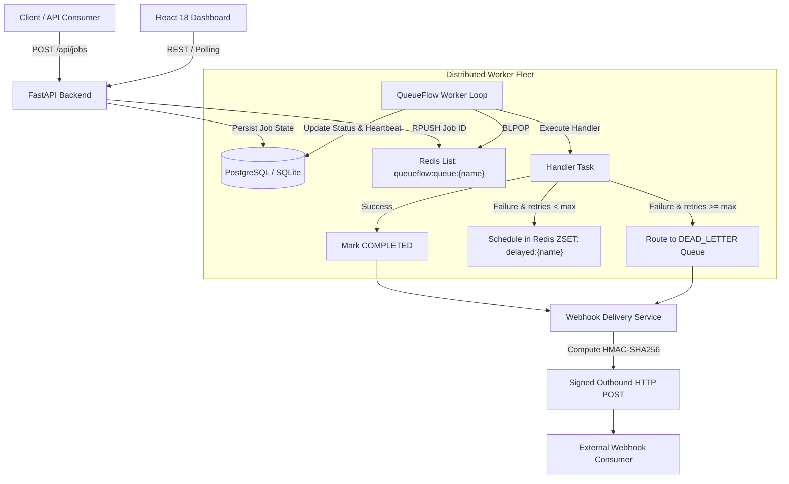

# QueueFlow — Distributed Job Processing & Webhook Delivery Platform

[](https://opensource.org/licenses/MIT)
[](https://python.org)
[](https://fastapi.tiangolo.com)
[](https://react.dev)
[](https://www.typescriptlang.org)
[](https://tailwindcss.com)
[](https://www.docker.com)

QueueFlow is an enterprise-grade, distributed background job processing and webhook notification platform designed for high throughput, fault tolerance, and developer observability.

---

## ⚡ Highlights & Key Capabilities

- **Distributed Task Execution**: Multi-worker architecture with Redis-backed reliable queueing.
- **Automatic Exponential Backoff**: Intelligent retry scheduling using Redis ZSETs ($delay = \text{base}^{\text{attempt}}$).
- **Dead-Letter Queue (DLQ)**: Automatic isolation of persistently failing jobs after exceeding retry limits, with one-click manual replay.
- **Cryptographic Webhooks**: Outbound event notifications signed with **HMAC-SHA256** and verification headers (`X-QueueFlow-Signature`).
- **Telemetry & Worker Heartbeats**: Real-time worker health monitoring, throughput charts, and queue depth metrics.
- **Polished SaaS Dashboard**: React 18, TypeScript, Tailwind CSS, and Recharts with live polling and interactive job inspection.
- **Production Ready**: Full Docker Compose setup, PostgreSQL, Redis, health checks, and 100% passing test suite.

---

## 🏗️ System Architecture



---

## 🚀 Quickstart

### 1. Run with Docker Compose (Recommended)

Run the entire cluster (PostgreSQL, Redis, FastAPI Backend, Background Worker, React Dashboard, and Nginx reverse proxy) with a single command:

```bash
docker-compose up --build
```

- **Frontend Dashboard**: [http://localhost:3000](http://localhost:3000)
- **FastAPI Interactive Docs**: [http://localhost:8000/docs](http://localhost:8000/docs)
- **Backend Health Check**: [http://localhost:8000/health](http://localhost:8000/health)

---

### 2. Run Locally (Standalone Mode)

QueueFlow includes an automatic in-memory FakeRedis and SQLite fallback so you can run and develop without installing external services!

#### Backend:
```bash
cd backend
python -m venv .venv

# On Windows:
.venv\Scripts\activate
# On Linux/macOS:
source .venv/bin/activate

pip install -r requirements.txt

# Seed sample data (optional)
python -m app.seed

# Start API server
uvicorn app.main:app --reload --port 8000
```

#### Frontend:
```bash
cd frontend
npm install
npm run dev
```

Open [http://localhost:5173](http://localhost:5173) in your browser.

---

## 🧪 Testing

Execute the comprehensive test suite with `pytest`:

```bash
cd backend
.venv\Scripts\pytest -v
```

### Verified Test Suite:
```
tests/test_jobs_api.py::test_create_job PASSED                           [  6%]
tests/test_jobs_api.py::test_get_job_by_id PASSED                        [ 13%]
tests/test_jobs_api.py::test_get_nonexistent_job_returns_404 PASSED      [ 20%]
tests/test_jobs_api.py::test_list_jobs_pagination_and_filter PASSED      [ 26%]
tests/test_jobs_api.py::test_cancel_job PASSED                           [ 33%]
tests/test_jobs_api.py::test_retry_job_endpoint PASSED                   [ 40%]
tests/test_metrics_api.py::test_metrics_api_counts PASSED                [ 46%]
tests/test_metrics_api.py::test_metrics_activity_endpoint PASSED         [ 53%]
tests/test_metrics_api.py::test_workers_api PASSED                       [ 60%]
tests/test_webhooks.py::test_hmac_signature_generation_and_verification PASSED [ 66%]
tests/test_webhooks.py::test_webhook_crud_api PASSED                     [ 73%]
tests/test_webhooks.py::test_webhook_dispatch_on_job_event PASSED        [ 80%]
tests/test_worker_engine.py::test_worker_successful_execution PASSED     [ 86%]
tests/test_worker_engine.py::test_worker_retry_with_exponential_backoff PASSED [ 93%]
tests/test_worker_engine.py::test_worker_dead_letter_queue_on_max_retries PASSED [100%]

======================== 15 passed in 0.49s ========================
```

---

## 📡 REST API Reference

| Method | Endpoint | Description |
|---|---|---|
| `POST` | `/api/jobs` | Enqueue a new background task |
| `GET` | `/api/jobs` | List jobs with pagination, status, and queue filters |
| `GET` | `/api/jobs/{id}` | Get full job telemetry and attempt history |
| `POST` | `/api/jobs/{id}/retry` | Manually retry a failed or DLQ job |
| `POST` | `/api/jobs/{id}/cancel` | Cancel a queued or pending job |
| `GET` | `/api/jobs/dlq` | List all jobs in the Dead-Letter Queue |
| `POST` | `/api/jobs/dlq/replay-all`| Bulk replay all Dead-Letter Queue jobs |
| `GET` | `/api/workers` | List worker nodes, heartbeats, and status |
| `GET` | `/api/metrics` | System-wide counts, queue depths, success rates |
| `GET` | `/api/metrics/activity` | Hourly time-series data for activity charts |
| `POST` | `/api/webhooks` | Register a new HMAC-signed webhook endpoint |
| `GET` | `/api/webhooks` | List registered webhook endpoints |
| `POST` | `/api/webhooks/{id}/test` | Send a test ping notification to verify HMAC |
| `GET` | `/api/webhooks/{id}/deliveries` | Audit log of outbound webhook attempts |

---

## 🔒 HMAC-SHA256 Webhook Verification

Every webhook notification includes security headers to prevent spoofing and replay attacks:

```http
POST /your-webhook-endpoint HTTP/1.1
Host: api.yourdomain.com
Content-Type: application/json
User-Agent: QueueFlow-Webhook/1.0
X-QueueFlow-Delivery: del_4829fa
X-QueueFlow-Event: job.completed
X-QueueFlow-Timestamp: 1731671234
X-QueueFlow-Signature: sha256=9b71d224bd62f3785d96d4...
```

### Python Verification Example:
```python
import hmac, hashlib

def verify_queueflow_webhook(secret: str, raw_body: bytes, timestamp: str, signature_header: str) -> bool:
    to_sign = f"{timestamp}.".encode("utf-8") + raw_body
    computed = "sha256=" + hmac.new(secret.encode("utf-8"), to_sign, hashlib.sha256).hexdigest()
    return hmac.compare_digest(computed, signature_header)
```

---

## 📂 Project Structure

```
queueflow/
├── docker-compose.yml           # Complete containerized multi-service setup
├── README.md                    # Setup & user guide
├── ARCHITECTURE.md              # Deep dive architecture & design decisions
├── PROJECT_STATE.md             # Development state, verification & roadmap
├── backend/
│   ├── Dockerfile
│   ├── requirements.txt
│   ├── pytest.ini
│   ├── app/
│   │   ├── main.py              # FastAPI application & lifecycle
│   │   ├── config.py            # Pydantic BaseSettings
│   │   ├── database.py          # SQLAlchemy engine & session factory
│   │   ├── models/              # Job, JobExecution, WebhookEndpoint, WorkerNode
│   │   ├── schemas/             # Request & Response Pydantic DTOs
│   │   ├── queue/               # RedisBroker, Worker loop, Handlers registry
│   │   ├── services/            # JobService, WebhookService, MetricsService
│   │   ├── api/v1/              # REST Endpoints (/jobs, /webhooks, /workers, /metrics)
│   │   └── utils/               # HMAC signing, security, structured logger
│   └── tests/                   # 15 unit and integration tests
└── frontend/
    ├── Dockerfile & nginx.conf  # Production web server
    ├── package.json & vite.config.ts
    └── src/
        ├── types/               # TypeScript interfaces
        ├── api/client.ts        # Typed API client
        ├── components/          # Reusable UI components & modals
        └── pages/               # Overview, Jobs, DLQ, Webhooks, Workers
```
